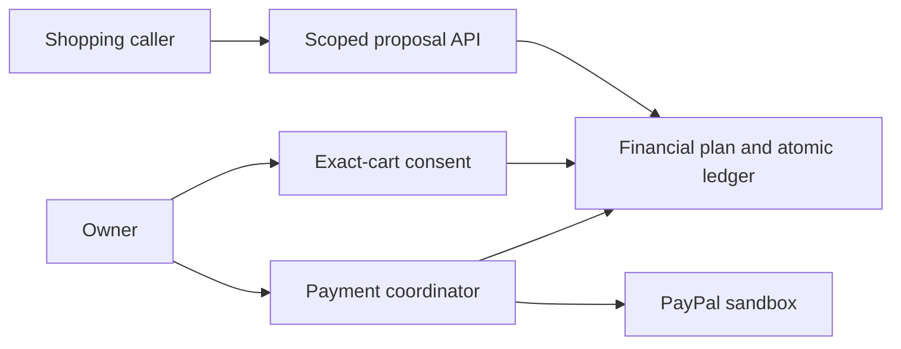

# GoalGuard

**A budget firewall for AI shopping agents.**

[](https://github.com/ankitks1209/GoalGuard-ai/actions/workflows/checks.yml)

GoalGuard checks purchase proposals against an owner-confirmed financial plan,
protecting bills, a cash buffer and a savings contribution. Approved purchases
can continue through PayPal sandbox checkout with exact-cart consent and an audit trail.

> **Development status:** the financial backend and scoped API work today. Core
> PayPal payment flows have sandbox evidence. Real model callers and the owner
> interface are still being built; the current local demo uses deterministic callers.

## What works

- Calendar-month plans with bill protection extending through the next expected payday.
- Cash-based purchase allocation and a separate expected-income forecast.
- Atomic shared reservations, 15-minute expiry and purchase-specific owner consent.
- Policy revisions, paired bill/savings records, received refunds and month rollover.
- PayPal sandbox authorization, capture, void, idempotent retry and status refresh.
- Scoped agent tools, bounded proposal recovery and allowlisted financial responses.

## Quick start

Requires **Python 3.11+**. The runtime has no third-party dependencies.

```sh
git clone https://github.com/ankitks1209/GoalGuard-ai.git
cd GoalGuard-ai
python3 -m venv .venv
source .venv/bin/activate
python -m pip install -e .
python demo.py
```

The demo uses isolated temporary state and synthetic products. It shows competing
purchases, a protected budget, a feasible counteroffer and owner approval. It makes
no PayPal or model-provider requests. Either concurrent purchase can win.

For the API, persistent state and owner plan setup, see [Getting started](docs/getting-started.md).

## How it works



Agents propose items and quantities. Trusted code computes prices, reserves
capacity and enforces authority. Owner confirmation and PayPal buyer approval
precede payment authorization. Unknown payment outcomes keep money committed
until a provider status refresh resolves them.

The planned AI layer handles request understanding, product selection, alternatives
and explanations. It will not calculate authoritative balances or grant consent.

## PayPal sandbox

```sh
cp .env.example .env
```

Fill the three sandbox credentials locally and follow [PayPal setup](docs/paypal-setup.md).
Keep `.env`, buyer passwords and runtime credentials private. The adapter is fixed
to the sandbox endpoint. Genuine buyer approval and manual demo fulfilment are required.

## Verification

```sh
python evaluate.py --require-tcp
python probe_evaluate.py
```

The committed local snapshot records **155 passed, 0 failed, 0 skipped**, including
eight TCP checks. Core sandbox evidence separately records a $1 capture, a same-key
capture replay and a second authorization followed by void. A deliberately
suppressed reply and subsequent real status refresh are labeled as a controlled fault.

See [Evaluation](docs/evaluation.md) for methods and limits, and [reports](reports/README.md)
for machine-readable snapshots. Local checks and CI do not call live providers.

## Documentation

- [Architecture and trust boundaries](docs/architecture.md)
- [Financial semantics](docs/financial-semantics.md)
- [HTTP API](docs/api.md)
- [PayPal setup](docs/paypal-setup.md)
- [Evaluation and evidence](docs/evaluation.md)
- [Roadmap](docs/roadmap.md)
- [Contributing](CONTRIBUTING.md) · [Security](SECURITY.md)

## Current limitations

Local development and sandbox use only. The catalog is synthetic and financial
inputs are self-reported. There is no bank synchronization, automatic savings
transfer, live model integration or owner browser interface yet. Proposal outcomes
can reveal partial capacity despite quotas. Long-duration PayPal behavior and
production security are unverified. See the [roadmap](docs/roadmap.md).

## License

[MIT](LICENSE).
