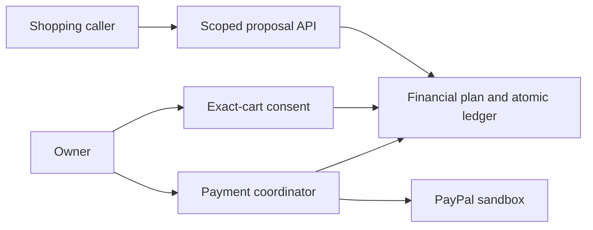

# GoalGuard

**A budget firewall for AI shopping agents.**

[](https://github.com/ankitks1209/GoalGuard-ai/actions/workflows/checks.yml)

GoalGuard checks purchase proposals against an owner-confirmed financial plan,
protecting bills, a cash buffer and a savings contribution. Approved purchases
can continue through PayPal sandbox checkout with exact-cart consent and an audit trail.

> **Development status:** the financial backend and scoped API work today. Core
> PayPal payment flows have sandbox evidence. Two real Flash-Lite callers have
> demonstrated shared-budget denial and recovery in one sequential scenario.
> Both used the same model; earlier incomplete Flash attempts remain documented.
> The owner interface connects manual plan setup, sample-only AI drafting,
> financial activity records, exact-cart review and the timeline.
> A real Gemini proposal reached owner consent and sandbox order creation on
> November 3. Buyer checkout stopped at a seller currency error.
> [Combined run evidence](reports/combined-demo-2026-11-03.json)
> The local `demo.py` uses deterministic callers.

## What works

- Calendar-month plans with bill protection extending through the next expected payday.
- Cash-based purchase allocation and a separate expected-income forecast.
- Atomic shared reservations, 15-minute expiry and purchase-specific owner consent.
- Policy revisions, paired bill/savings records, received refunds and month rollover.
- PayPal sandbox authorization, capture, void, idempotent retry and status refresh.
- Scoped agent tools, bounded proposal recovery and allowlisted financial responses.

## Quick start

For a browser walkthrough with a prepared synthetic household and no provider
keys, see [the local judging build](docs/judging.md).

Requires **Python 3.11+**. The Python runtime has no third-party dependencies.

```sh
git clone https://github.com/ankitks1209/GoalGuard-ai.git
cd GoalGuard-ai
python3 -m venv .venv
source .venv/bin/activate
python -m pip install -e .
python demo.py
```

The demo uses isolated temporary state and synthetic products. It shows competing
purchases, a protected budget, a feasible counteroffer and owner approval. It makes
no PayPal or model-provider requests. Either concurrent purchase can win.

For the API, persistent state and owner plan setup, see [Getting started](docs/getting-started.md).

The React/TypeScript/Vite owner workspace uses Node 24/npm. Install its locked
dependencies with `npm --prefix frontend ci`, build with
`npm --prefix frontend run build`, then start `python server.py` from this source
checkout and open its printed loopback URL. The built interface and API share
one origin. Unlock using your private local owner token; never paste that token
into a model or commit it. The interface includes manual plan preview/confirmation,
exact-cart review, separate payment steps and a timeline. Optional AI drafting
sends only a displayed built-in sample after consent; private financial text is
not accepted. Financial activity records have their own review/confirmation and
same-ID recovery after an uncertain response. These records do not move money.
See [frontend setup](frontend/README.md) for checks and scope and
[browser CI repair](agent_docs/browser-ci-repair.md) for hosted verification.
A new combined AI-to-payment demo remains unverified.

## How it works



Agents propose items and quantities. Trusted code computes prices, reserves
capacity and enforces authority. Owner confirmation and PayPal buyer approval
precede payment authorization. Unknown payment outcomes keep money committed
until a provider status refresh resolves them.

The AI loop is designed for request understanding, product selection, alternatives
and explanations. It does not calculate authoritative balances or grant consent.
See [real model caller setup](docs/agents.md) and [observed runs](reports/gemini-demo.json)
for the demonstrated scope and remaining verification.

## PayPal sandbox

```sh
cp .env.example .env
```

Fill the three sandbox credentials locally and follow [PayPal setup](docs/paypal-setup.md).
Keep `.env`, buyer passwords and runtime credentials private. The adapter is fixed
to the sandbox endpoint. Genuine buyer approval and manual demo fulfilment are required.

## Verification

```sh
python evaluate.py --require-tcp
python probe_evaluate.py
```

The November 11 local working-tree verification records **231 passed, zero
failures/errors/skips, nine TCP checks**, **85.43% branch-aware coverage**, and
successful build/pre-commit gates. The frontend gate passed with **93.57% branch
coverage**. See [owner-form verification](agent_docs/owner-form-verification.md)
for its historical snapshot and [browser CI repair](agent_docs/browser-ci-repair.md)
for current hosted-check scope and limits.

The historical committed local snapshot records **155 passed, 0 failed, 0 skipped**, including
eight TCP checks. Core sandbox evidence separately records a $1 capture, a same-key
capture replay and a second authorization followed by void. A deliberately
suppressed reply and subsequent real status refresh are labeled as a controlled fault.

See [Evaluation](docs/evaluation.md) for methods and limits, and [reports](reports/README.md)
for machine-readable snapshots. Local checks and CI do not call live providers.

## Documentation

- [Product specification](docs/spec.md)
- [AI contributor contract](AGENTS.md) · [Engineering setup verification](agent_docs/setup-verification.md)
- [Architecture and trust boundaries](docs/architecture.md)
- [Financial semantics](docs/financial-semantics.md)
- [HTTP API](docs/api.md)
- [PayPal setup](docs/paypal-setup.md)
- [Real model caller setup and limits](docs/agents.md)
- [Owner text to an unconfirmed plan](docs/plan-drafting.md) — one live synthetic-input draft verified
- [Evaluation and evidence](docs/evaluation.md)
- [Roadmap](docs/roadmap.md)
- [Contributing](CONTRIBUTING.md) · [Security](SECURITY.md)

## Current limitations

Local development and sandbox use only. The catalog is synthetic and financial
inputs are self-reported. There is no bank synchronization, automatic savings
transfer. The initial browser interface still needs broader accessibility/device
review and a combined provider demonstration. Repeated/adversarial model evaluation is pending. Proposal outcomes
can reveal partial capacity despite quotas. Long-duration PayPal behavior and
production security are unverified. See the [roadmap](docs/roadmap.md).

## License

[MIT](LICENSE).
