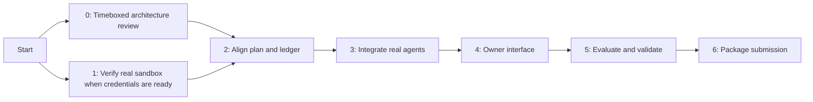

# GoalGuard — implementation plan

**Status (17 October 2026):** core sandbox gate passed without fallback. Actual
authorize/capture, authorize/void, same-key replay, controlled response-loss
recovery and local amount guard are recorded in `sandbox-results.json` and
`SANDBOX_VERIFICATION.md`. The user resumed implementation. The core financial-plan
backend is implemented with 43 new local cases; the complete suite has 155 passes,
zero skips and eight TCP cases. The next milestone is connecting real agents,
pending model access. The owner interface and natural-language drafting remain
unfinished. Provider final-failure classifications without supporting evidence
remain conservatively pending; that follow-up is not claimed complete.
**Companion:** [GOALGUARD_BLUEPRINT.md](GOALGUARD_BLUEPRINT.md).

## Build order

User interviews can begin during milestone 0 and inform every later milestone.
Milestones 0 and 1 run independently; do not wait for design review to begin the
isolated sandbox check. The current review has supplied corrections to apply;
the sandbox check has now completed with actual provider evidence. Credentials are
configured. Core payment setup no longer blocks the later milestones.
UI sketches can be reviewed early; payment or UI code is not a substitute for
closing the sandbox gate. Existing code remains a spike until reviewed for reuse.

## Milestone 0 — agree on the product and architecture

**Work:** review audience, scenario, financial semantics, proposed modules, scope
and evidence categories. Review three screen descriptions and the exact demo story.
Choose the initial goal/bill inputs, supported product requirements and model
credentials. Prepare five short interviews; do not message people without explicit
authorization.

**Deliverables:** reviewed blueprint, bounded backlog, decision log and interview
notes where available.

**Exit gate:** the owner can explain what GoalGuard protects, what remains outside
its control, and what the first demo must prove. The user's direction is to apply
the review corrections and move to sandbox. Unclear provider details remain
explicit dependencies rather than assumptions.

**Hard timebox:** 30 minutes in one sitting: 10 minutes for period/formulas/goals,
10 for the three screens and demo, 10 for gates and defaults. At the end, adopt
documented defaults for ordinary undecided choices and log unresolved dependencies.
Interview scheduling and credential setup do not extend architecture review.
This timebox does not treat silence as user approval to resume product changes.

## Milestone 1 — verify the real PayPal sandbox lifecycle

**Dependency:** sandbox business app/client credentials and personal buyer account.

**Work:** use a small isolated test order. Exercise create/approve/authorize/capture
and a separate authorize/void order. Confirm exact-amount enforcement before the
capture API, provider idempotency on retry and refresh after an interrupted local
response. Store redacted actual responses as new fixtures with provenance.

Do not build the agent or owner UI around a response shape inferred solely from
handwritten fixtures. If account permissions or actual responses invalidate the
adapter, correct the architecture before proceeding.

**Deliverables:** sandbox verification report, redacted provider fixtures and
documented differences from the intended contract.

**Exit gate:** both settlement and cancellation paths complete using actual buyer
approval, with correct local accounting. The report separates tested provider
behavior from documented honor-period/expiry rules.

**Estimate:** 1–2 focused engineering days after credentials are ready.

## Milestone 2 — align the financial plan and ledger

**Implemented:** calendar-month plans, named bills/buffer/goal, future bill horizon,
forecast separation, owner preview/confirmation, off-track goal schedules, paired
cash records, bounded financial revisions, approval invalidation, authorized
obligation preservation, received refunds and owner-confirmed rollover. See
`FINANCIAL_PLAN_API.md` and `tests/test_plans.py`. Local scope is verified; this
financial integration has not yet been run through a new actual sandbox lifecycle.

**Clarification from implementation review:** after the expected income is fully
recorded as received, require the next expected payday before new purchases. This
prevents a stale received payday from shortening future bill protection.

**Work:** add calendar-month reporting and the bill protection cutoff extending
through the next expected income date, plus structured bill/buffer/goal records,
deterministic monthly goal schedule and separate available-cash/forecast totals.
Show infeasible, waiting-income and zero-capacity states before owner activation.
Implement uniquely identified cash adjustments, bounded policy revisions and
transactional invalidation of pre-payment approvals. Retain captured spending and
defer financial policy activation only during in-flight/uncertain payment calls.
Allow edits with verified authorizations while preserving their reservations;
capture/void retain their original terms across policy changes. Record paired
savings transfers, manual received refunds and the owner-confirmed rollover
contract, retaining obligations and avoiding historical double deduction.
Define opening-cash semantics and prevent historical double deduction. Reuse reviewed transaction,
expiry, cart-binding and payment-intent code. Make explanations traceable to
confirmed commitments.

After milestone 1 establishes actual provider response semantics, add verified
final-failure classification so definitively failed payments can release capacity.
Unknown outcomes remain committed. This branch is not implemented in the spike.

Retain one explicit invariant. Reservation and consumption happen inside write
transactions. Payment uncertainty keeps capacity committed. For the demo, resets
use fresh isolated state; they cannot erase live authorizations.

**Deliverables:** domain schema, plan/policy API contract, meaningful regression
cases and an audit record linking purchases to the active plan.

**Exit gate:** period boundaries and goal arithmetic are deterministic; future
income never grants purchase authority; deficits are visible; revision/authorization
races cannot use stale consent. The 30 October/1 November rent case, savings
pairing, post-revision capture, late income and rollover cases preserve accounting.
Named goals/bills explain protected money; concurrency, retries,
TTL, capture/void and process-kill recovery preserve accounting. Schema changes do
not silently rotate signing keys or invalidate ongoing operations.

**Estimate:** 2–3 focused engineering days.

## Milestone 3 — connect real agents

**Dependency:** two usable model configurations and a stable proposal API.

**Work:** implement a small provider adapter and trusted tool dispatcher. Each
agent gets its own scope. Expose catalog, proposal, redacted own-purchase status
and optional headroom only. Add response allowlists before giving tools to external
models; bills, income, buffer, goals and owner audit stay private. Remove mandatory
budget inspection in the first comparison under identical restricted API scopes.
Enforce eight-call/one-revision initial bounds in code, with configurable limits.
Use structured denials and counteroffers for recovery. Handle malformed model
output through validation or clarification.

Support schema-validated natural-language plan drafts as an owner-requested input
helper. Only the owner-confirmed plan becomes active; retain manual entry when a
model cannot interpret the request.

Implement one model-invoked proposal skill and its denial reference, following
the blueprint's interface contract. Map its proposal tool to the existing strict
HTTP endpoint and implement actual skill discovery for each agent adapter.
Keep request keys in trusted transport; preserve keys after uncertain outcomes.

Start with the prepared minimal prompt. Compare its behavior with an incumbent
or deliberately documented baseline before adding detailed instructions. Agents
must never receive owner tokens, signing keys or payment credentials.

**Deliverables:** two actual model callers, recorded tool transcripts, runner
limits, one proposal skill/reference and honest baseline/ablation configuration.
Keep ablation of reasoning guidance separate from immutable enforcement checks.

**Exit gate:** both agents use the same gateway and recover from a legitimate
budget denial; attempts to grant consent or alter prices are rejected in code.
Calling two deterministic fixtures does not satisfy this gate.

**Estimate:** 1–2 focused engineering days, subject to provider access.

## Milestone 4 — implement the owner experience

**Work:** build the three-screen flow from the blueprint using one same-origin
frontend. Keep plan confirmation, exact-cart consent, PayPal approval and merchant
fulfilment distinct. Use clear pending/error states and an audit timeline. Add a
server-managed owner session and request protection before browser money actions.
Place agent requests and payment progress inside purchase approval, rather than
creating additional screens.

Expose manual status refresh for uncertain outcomes. Show synthetic catalog and
manual fulfilment labels. Never call a confirmed budget allocation a savings
deposit or claim that a local timeout cancelled a PayPal hold.

**Deliverables:** owner review interface, callback/status flow and cancellation
branch, all driven by the same verified backend.

**Exit gate:** a new viewer can complete a purchase or cancel it without a terminal;
unknown outcomes remain visibly pending and cannot be captured twice.

**Estimate:** 2–3 focused engineering days.

## Milestone 5 — evaluate and validate

**Work:** replace the broad bundled engineering skill with at most three explicit
builder workflows: sandbox verification, evaluation and ledger-change review.
Back each with the existing runnable checks and evidence categories; do not install
or claim a workflow is validated merely because its Markdown exists.
Run prompt/skill ablations once the agent harness works; owner-flow cases follow
milestone 4. Use bounded parallel workers only for independent repeated trials,
while concurrency cases deliberately share a ledger.

Run the recorded scenario set against the per-purchase baseline, the
single-LLM memory baseline and gateway-backed agent. Include sequential controls
and document concurrency semantics. Initially aim for ten recorded repetitions
per scenario, preserving successes and failures. The first explicit batch is
three scenarios times ten repetitions times three comparisons (90 runs), plus
ten sequential single-LLM controls (100 total). The single-LLM comparison has
30 scenario runs and ten controls. All counts are planned until executed.
Report accepted violations,
legitimate completion, false denials, recovery quality, latency and cost.

Conduct the five user conversations and revise only behavior supported by the
findings. Do not add another product merely because an interview suggests it.
Re-run affected checks after relevant changes, rather than repeatedly broadening
the suite with tests that only mirror implementation.

**Deliverables:** evaluation tables with raw-run provenance, user findings and a
known-limitations list.

**Exit gate:** no known accepted budget/consent violation in the specified suite;
legitimate users can complete the demo. If a baseline does not fail, report that
honestly. A finite passing suite is not a universal safety claim.

**Estimate:** 1–2 focused engineering days plus participant availability.

## Milestone 6 — package the submission

**Work:** verify a clean local installation; prepare the public licensed repository
and complete instructions. Choose local judging setup or a separately reviewed
hosted demo. Prepare a video shorter than three minutes and record a sandbox backup.
Write the audience/problem, architecture, PayPal/AI roles, evidence and limitations.

**Deliverables:** runnable submission, documentation, public repository when
authorized, video and submission text.

**Exit gate:** a judge can run or interact with a functional build; its demonstrated
behavior matches the write-up. Publishing the repository/video or deploying requires
the user's authorization at that stage.

**Estimate:** 1–2 focused engineering days.

## Planning envelope and fallback

Allow roughly 9–14 focused engineering days after architectural decisions and
credentials are ready, plus external delays. These estimates are planning ranges,
not a schedule or guarantee. Check the official submission deadline before turning
them into calendar dates.

If time shrinks, retain one household, one goal, one bill, a tiny catalog, manual
reconciliation and both sandbox payment branches. Defer MCP packaging, hosted
deployment, complex policy editing, multiple goals and webhook automation. Retain
the existing plan, consent and payment evidence requirements.

## Risk register

| Risk | Early action | Stop or reduce scope when |
|---|---|---|
| PayPal permission/response mismatch | Milestone 1 before dependent features | Sandbox cannot support the approved flow |
| Goal awareness remains cosmetic | Store and show named commitments | Explanations cannot be traced to confirmed inputs |
| Weak demand | Five concrete user conversations | Target users cannot describe a relevant problem |
| LLM output or latency problems | Small schema and bounded tools | Agents cannot complete ordinary scenarios reliably |
| Demo-only authentication exposed publicly | Local-first deployment | Public hosting would bypass the reviewed trust boundary |
| Unknown payment outcome causes wrong release | Durable intent and read-only reconciliation | Provider outcome is unresolved |
| Excess scope | Milestone gates and bounded backlog | A new feature delays the core payment demonstration |

## Working agreement

Plan first, implement a reviewed slice, verify the slice, then move to the next
gate. Keep existing work recoverable. Record decisions and changes to this plan
with their reason. The engineering skill supports this sequence; it does not
authorize additional financial actions, deployments, messages or maintenance jobs.
