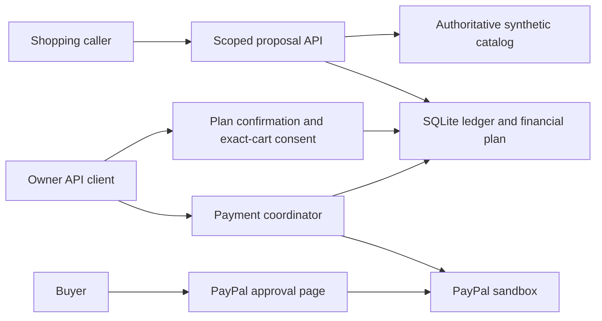
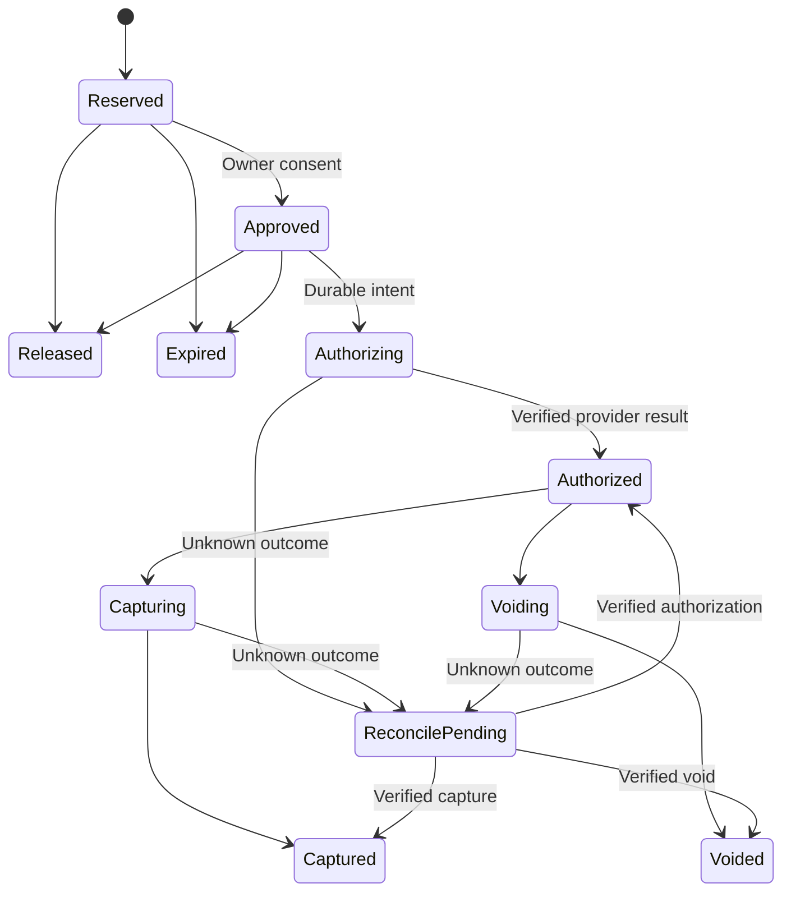

# Architecture

GoalGuard is a local Python backend with a SQLite ledger and a thin HTTP tool API.
It protects an owner-confirmed financial plan while shopping callers propose
purchases. The local demo uses deterministic callers. A Gemini adapter and
real-model CLI are implemented separately. Two Flash-Lite callers demonstrated
one sequential shared-budget denial/recovery scenario through the scoped HTTP
API. Both used the same model; real-agent concurrency remains unverified.
Earlier incomplete Flash attempts are retained in the evidence.

## Modules

| Module | Responsibility |
|---|---|
| `goalguard/finance.py` | Validate dates, currency and money; calculate protection, savings installments and forecast |
| `goalguard/plans.py` | Owner preview/confirmation, separate bill/goal records, cash events, revisions and rollover |
| `goalguard/ledger.py` | Atomic reservations, consent signatures, expiry, durable payment operations and audit |
| `goalguard/catalog.py` | Server-owned prices and deterministic alternatives in the synthetic catalog |
| `goalguard/gateway.py` | Actor scopes, quota enforcement and payment coordination |
| `goalguard/agent_view.py` | Allowlisted public agent responses |
| `goalguard/runner.py` | Trusted dispatcher with an eight-call, one-revision limit and fixed skill resources |
| `goalguard/http_tools.py` | Agent-only loopback client; no owner or payment methods |
| `goalguard/models.py` | Gemini transport, explicit configuration and provider failure classification |
| `goalguard/shopping.py` | Bounded model/tool loop and private run records; one sequential scenario observed |
| `goalguard/drafting.py` | Explicitly requested, schema-validated initial plan extraction; one real synthetic-input draft observed |
| `agent.py` | Source-checkout caller using one scoped agent token and configurable model |
| `draft_plan.py` | Disposable owner draft demonstration; never confirms a plan or calls PayPal |
| `goalguard/paypal.py` | Fixed sandbox endpoint, provider calls and exact order/amount validation |
| `server.py` | Loopback HTTP transport, scoped development tokens and expiry sweep |

## Allocation and payment are separate

A local reservation reduces discretionary capacity before buyer approval. It is
not a PayPal funds hold. After buyer approval, PayPal authorization creates a
provider payment authorization. The same purchase stays counted once throughout.

Pre-payment reservations expire 15 minutes after original reservation, including
at the exact deadline. Approval/retries do not extend the TTL. Once payment I/O
starts, a local deadline cannot release the obligation. Captured spending remains
deducted. See [financial semantics](financial-semantics.md).

## Transaction and recovery boundary

`BEGIN IMMEDIATE` serializes SQLite writers, including different households.
Quota claims bind to the active plan period; a period change before reservation
requires a same-key retry. Allocation and the current policy check happen under
the write lock. Financial revisions invalidate pre-payment approvals atomically.

Provider I/O happens outside the database transaction. Before it starts, the
ledger persists an operation with its original cart, amount and provider IDs.
Completed retries return the stored result; an uncertain result requires status
refresh. PayPal receives the operation ID as `PayPal-Request-Id`.
This is a single-instance prototype, not a horizontally scaled database design.

## Agent and owner authority

Agent tools expose catalog items, purchase proposals and redacted own-purchase
status. The server owns merchant, price and delivered total. Agents cannot supply
approval flags, owner credentials or payment amounts. Owner-only routes confirm
plans, grant cart-bound consent and execute payment actions.

Responses exclude bills, income, buffer, savings goals, owner audit, provider IDs
and consent permits. An optional legacy budget route returns a conservative $50
headroom floor; default model tools omit it. Counteroffers expose at most one
feasible catalog alternative, not the exact remaining balance.
Three distinct proposals per agent/plan period include denials. Same-key/same-cart
retries reuse a quota slot. Decision outcomes still permit partial inference.

## Implemented scope

The financial backend is locally verified. Core authorize/capture and
authorize/void flows have separate actual sandbox evidence. That observation run
predates the financial-plan integration. Broader model caller verification,
broader initial plan drafting evaluation, owner UI integration and user
validation remain unfinished. One real synthetic-input extraction saved a draft
without activation; it did not exercise shopping or PayPal.
Local owner-session backend protection has deterministic handler and TCP
tests: opaque 30-minute cookies, logout/restart invalidation, session-bound CSRF
and expected Origin/Host. Session expiry preserves uncertain payments; fixture
refresh after unlocking does not issue another capture. The initial frontend now
handles unlocking, expiry, deliberate retry and the three owner screens. Built
assets use the API origin. Browser inspection with disposable synthetic data
verified unlocking, keyboard cart approval and timeline recording. AI drafting and
paired financial-event UI, broader browser review and a combined provider flow remain.
The [roadmap](roadmap.md), [evaluation](evaluation.md) and [security policy](../SECURITY.md)
describe the remaining work and evidence limits.
